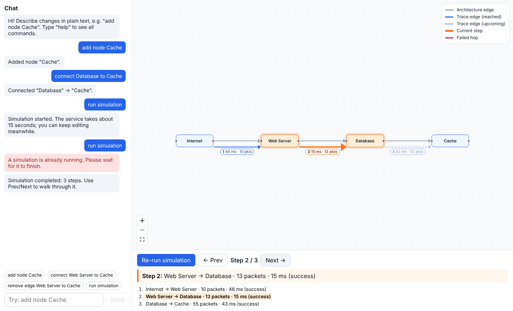

# Architecture Chat + Simulation Explorer

A small web app where you **edit a system architecture by typing text instructions**, see it drawn on a **React Flow canvas**, and **run a simulation** whose trace is overlaid on the canvas and can be stepped through.



- **Frontend:** React + TypeScript + Vite + [`@xyflow/react`](https://reactflow.dev) (React Flow v12)
- **Backend:** the supplied `simulation_service.py` (FastAPI), run separately and **used unmodified** as a third-party API
- **No LLM** – instructions are interpreted by a small, tested, rule-based parser

---

## Run it locally

You need **Node 18+** and **Python 3.10+** (the supplied service uses `str | None` type syntax). Use two terminals.

**Terminal 1 – simulation service** (port 8000)

```bash
cd backend
python -m pip install fastapi uvicorn
python -m uvicorn simulation_service:app --reload
# interactive docs: http://127.0.0.1:8000/docs
```

**Terminal 2 – web app** (port 5173)

```bash
cd frontend
npm install
npm run dev
# open http://localhost:5173
```

Other commands (from `frontend/`): `npm test` (37 unit tests), `npm run build` (typecheck + production build).

> The service deliberately takes **~15 seconds** per simulation. The app shows live progress (`queued → running → completed`) and you can keep editing the architecture while you wait.

---

## Supported inputs

Matching is case-insensitive. Labels can be quoted. Click the example chips under the chat box to try them.

| You type | What happens |
| --- | --- |
| `add node Cache` (also `add a node called Cache`, `create component Cache`, `add Cache`) | Adds a node labelled "Cache" in the first free grid slot |
| `connect Web Server to Cache` (also `add edge from A to B`, `link A with B`, `A -> B`) | Adds an edge A → B |
| `remove node Cache` (also `delete Cache`) | Removes the node **and every edge touching it** |
| `remove edge Web Server to Cache` (also `delete connection between A and B`, `disconnect A from B`) | Removes that edge (also matches if it points the other way) |
| `rename Database to Postgres` | Renames a node |
| `run simulation` (or the button) | Calls the simulation service and draws the trace |
| `undo`, `reset`, `help` | Undo the last change, restore the starting architecture, list commands |

**Error handling.** Unknown node names, duplicate labels, duplicate edges, self-loops and gibberish never change the architecture; the chat explains what went wrong (e.g. lists the existing nodes).

**Tip:** a label that begins with the word "node" or "component" should be quoted: `add node "Node Manager"`.

### Reading the canvas

| Look | Meaning |
| --- | --- |
| Grey arrow | Architecture edge |
| Blue arrow, drawn just beside the grey one, with `ms · pkts` label | Simulation trace edge already reached |
| Dashed pale blue | Trace edge for an upcoming step |
| **Thick orange** + orange-glowing nodes | The **current** step and its two nodes |
| Red | A hop whose status is failed/error/timeout |
| Light blue node | Node that takes part in the trace |

Use **Prev / Next** (or click any step in the list) to move through the trace. The step panel shows the current step number and description.

> The trace comes from the service, which does **not** know about architecture edges (see below), so a trace hop can connect two nodes that have no architecture edge between them. That is exactly why trace edges are drawn separately from architecture edges.

---

## How the app talks to the simulation API

All service access lives in one file: **`frontend/src/api.ts`**. The service is asynchronous:

1. **Start.** `POST /simulate` with the nodes:
   ```json
   { "nodes": [ { "id": "node_…", "type": "Internet" }, { "id": "node_…", "type": "Web Server" } ] }
   ```
   (`type` carries the label; it is the service's only optional field.) The service answers **`202`** with `{ "simulation_id": "…", "status": "queued", "edges": null }`.
2. **Poll.** Every second the app calls `GET /simulate/{simulation_id}` and reports the status (`queued` → `running`) in the button and chat, until the status is `completed` (give-up after 60 s, with a readable error).
3. **Normalise.** The completed response carries `edges` (`source`, `target`, `latency_ms`, `packets`, `status`). Each becomes one **step** with a description such as `Internet → Web Server · 64 packets · 18 ms (success)`.
4. **Display.** Steps are drawn as trace edges; the Prev/Next controls move the highlight.

The browser calls `/sim/*`, which the Vite dev server **proxies** to `http://127.0.0.1:8000` (see `vite.config.ts`). That avoids CORS configuration on a service we treat as third-party. Set `SIM_API_TARGET` to point at another host, or `VITE_SIM_API_URL` to call the service directly.

No simulation data is hard-coded in the frontend: every trace shown comes from a live response (and it is randomised by the service, so two runs differ).

### What the service does with our data (and how we deal with it)

- It accepts **only nodes**. Architecture edges are not sent because the service has no field for them and would ignore them.
- It builds the trace as a path **in the order the nodes arrive**: first node = source, last node = destination, middle nodes shuffled. Therefore the app sends nodes in **topological order** (entry points first, sinks last, unconnected nodes at the end; see `orderNodes()` in `architecture.ts`) instead of creation order, so the source/destination are meaningful (Internet → … → Database).
- Because the middle is shuffled, the order of intermediate hops can change between runs. That is the service's behaviour, not a bug in the app.

---

## Project layout

```
backend/
  simulation_service.py        the supplied service (unmodified)
frontend/src/
  parser.ts        text -> Command           (pure, unit tested)
  architecture.ts  Command + Architecture -> new Architecture; node ordering   (pure, unit tested)
  api.ts           the only code that calls the simulation service (POST + polling)
  App.tsx          state + wiring (chat, undo, simulation progress, stale detection)
  components/
    Canvas.tsx     builds React Flow nodes/edges, highlights the current step, re-fits the view
    TraceEdge.tsx  custom edge: offset + coloured so it never hides the architecture edge
    Chat.tsx       message history + input
    StepPanel.tsx  run button + progress, step counter, description, prev/next
  commands.test.ts parser + architecture tests
  api.test.ts      async polling, error handling, node ordering tests
```

## Key design decisions and assumptions

- **Rule-based parser, not an LLM** – deterministic, instant, free, testable. The brief explicitly allows any reasonable approach.
- **Parser and state logic are separate and pure.** The parser only produces a `Command`; `applyCommand` returns a *new* architecture and never mutates. That makes undo a one-line stack and the logic easy to test.
- **React Flow compatible data.** Nodes are `{ id, position, data: { label } }`, edges are `{ id, source, target }`, with ids in the `node_<uuid>` / `edge_<uuid>` style of the example. The state is passed to `<ReactFlow>` unchanged.
- **Trace edges are separate edges**, drawn by a custom edge type, offset to the side and coloured differently, so they are clearly distinguishable from architecture edges even when they follow the same connections.
- **Async integration done properly.** POST returns 202, so the app polls with a timeout; it shows progress, blocks a second concurrent run, and lets you keep chatting.
- **Nodes are sent in topological order** because the service derives its path from node order.
- **Labels are unique** (case-insensitive) so "connect A to B" is never ambiguous.
- **Removing a node removes its edges**, so React Flow never holds a dangling edge.
- **Stale trace detection.** If the architecture changes after a simulation, a warning appears and trace steps that reference removed nodes are hidden, rather than silently showing wrong data.
- **Failed service calls** (service not running, 4xx/5xx, timeout) show a clear message in the chat and leave the architecture and previous trace untouched.
- **Text is the source of truth.** Deleting with the keyboard and drawing edges with the mouse are disabled; nodes can only be dragged to rearrange.
- **Persistence.** The architecture is saved in `localStorage` (use `reset` to start over).

## Limitations / ideas for more time

- Phrasing is limited to the patterns listed; a fuzzy matcher or an LLM could handle looser sentences.
- Single-line commands only (no "add A and B, then connect them").
- Auto-layout is a simple grid; a layout library (dagre/elk) would suit larger diagrams.
- Polling is fixed at 1 s; exponential backoff and cancellation would suit a production service.
